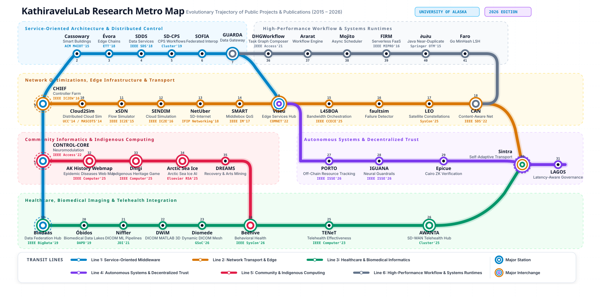

# KathiraveluLab Research Metro Map

An interactive evolutionary transit map tracking how the public research repositories and publications in [KathiraveluLab](https://github.com/KathiraveluLab) connect and evolve across distributed systems, network optimization, biomedical imaging, autonomous trust, and community science.



---

## Transit Lines Overview

The metropolitan map organizes **41 flagship research stations** across **6 interconnected transit lines**, reflecting over a decade of research (2014 - 2026):

| Line | Name | Color | Core Research Focus |
| :--- | :--- | :---: | :--- |
| **Line 1** | **Service-Oriented & Distributed Middleware** | Cyan (`#0284c7`) | Closed-loop neuromodulation, context-aware smart buildings, service chaining, CPS, and federated interoperability. |
| **Line 2** | **Network Transport & Edge Infrastructure** | Amber (`#d97706`) | Cloud/MapReduce simulation, dynamic flow modeling, community network controller farms, middlebox QoS, bandwidth orchestration, fault detectors, and LEO satellite constellations with inter-satellite links. |
| **Line 3** | **Healthcare & Biomedical Informatics** | Emerald (`#059669`) | High-throughput DICOM ML pipelines, dynamic telemedicine routing mesh, behavioral health data federation, and rural telehealth. |
| **Line 4** | **Autonomous Systems & Decentralized Trust** | Purple (`#7c3aed`) | Blockchain-based edge middleware, verifiable off-chain state channels, Cairo ZK proofs, latency-bounded governance, and neural guardrails. |
| **Line 5** | **Community Informatics & Circumpolar Computing** | Coral (`#e11d48`) | Alaska Native epidemic history mapping, Indigenous serious games, Arctic sea ice forecasting, and art therapy mining. |
| **Line 6** | **High-Performance Workflow & Systems Runtimes** | Slate Gray (`#64748b`) | Hypergraph workflow composition, Mojo SIMD execution, lock-free task orchestration, and Go deduplication. |

---

## Key Transfer Hubs & Interchanges

- **`Bindaas` (#19)**: Major Western transfer hub bridging **Line 1 (SOA Middleware)** and **Line 3 (Clinical Healthcare & Biomedical Informatics)**, federating heterogeneous clinical repositories and providing the foundational RESTful data architecture for **`Óbidos`**.
- **`CHIEF` (#9)**: Transfer hub bridging **Line 1 (SOA Middleware)** and **Line 2 (Network Transport)**, coordinating software-defined community network controller farms.
- **`Viseu` (#8)**: Major triple-interchange bridging **Line 1 (SOA Middleware)**, **Line 2 (Network Optimization)**, and **Line 4 (Autonomous Decentralized Trust)**, connecting edge orchestration directly with Ethereum trust and private off-chain state channels to **`PORTO`**.
- **`Beehive` (#24)**: Interdisciplinary junction connecting **Line 3 (Clinical Healthcare)** with **Line 5 (Community Informatics)**.
- **`Sintra` (#30)**: Major triple-interchange bridging **Line 2 (Network Transport)**, **Line 3 (Clinical Healthcare)**, and **Line 4 (Autonomous Systems & Decentralized Trust)** across satellite, edge, and zero-knowledge trust channels.
- **`GUARDA` (#7) & `CAN` (#18)**: Dual-interchange transfer stations bridging **Line 1 (SOA Middleware)** and **Line 2 (Network Transport)** directly into **Line 6 (Workflow & Systems Runtimes)** for high-throughput pipeline dispatching.

---

## Flagship Publications & Station Directory

### Line 1: Service-Oriented & Distributed Middleware
1. **CONTROL-CORE** ([`controlcore-project`](https://github.com/controlcore-project)): Closed-loop peripheral neuromodulation (*IEEE Access'22*, *Springer Cluster'25*), orchestrating feedback loops via the NEXUS software-defined workflow framework.
2. **Cassowary** (`Cassowary`): Context-aware smart buildings and decentralized SD-MANETs for IoT & smart homes (*ACM M4IOT'15*, *IJCAC'26*).
3. **Évora** (`Evora`): Adaptive edge service chaining (*Trans. Emerging Tel. Tech. (ETT)'18*, *IEEE ICWS'16*).
4. **SDDS** (`SDDS`, `messaging4transport`): Software-defined data services (*IEEE SDS'18*).
5. **SD-CPS** (`SD-CPS`): Software-defined cyber-physical systems (*Springer Cluster'19*, *IEEE SDS'17*).
6. **SOFIA** (`SOFIA`): Service-oriented federated interoperability in Erlang.
7. **GUARDA** (`GUARDA`): Uniform remote data and analytics gateway in Elixir.
8. **Viseu** (`Viseu`): Virtual Internet services at the edge and decentralized blockchain framework (*Computer Networks (COMNET)'22*).

### Line 2: Network Transport & Edge Infrastructure
9. **CHIEF** (`CHIEF`, `messaging4transport`): Controller farm for clouds of software-defined community networks (*IEEE IC2EW'16*).
10. **Cloud2Sim** (`Cloud2Sim`): Adaptive distributed simulator for Cloud and MapReduce algorithms (*IEEE/ACM UCC'14*, *IEEE MASCOTS'14*).
11. **xSDN** (`xSDN`): Expressive simulator for dynamic network flows (*IEEE IC2E'15*).
12. **SENDIM** (`SENDIM`): Cloud network simulation, emulation, and deployment (*IEEE IC2E'16*, *Springer OTM'16*).
13. **NetUber** (`NetUber`): Software-defined Internet routing and dynamic IXP peering via Dynam-IX (*ACM SIGCOMM / CoNEXT'18*, *IFIP Networking'18*, *IEEE SDS'20*).
14. **SMART** (`SMART`, `messaging4transport`): SDN middlebox architecture for resilient transfers (*IEEE IM'17*, *Springer OTM'16*).
15. **L4SBOA** (`L4SBOA`): L4S bandwidth orchestration for ultra-low latency (*IEEE CCECE'25*).
16. **faultsim** (`faultsim`): Distributed cluster failure detector under extreme network instability in Rust.
17. **LEO** (`LEO`): Low Earth Orbit satellite network simulation with inter-satellite links (*IEEE SysCon'25*).
18. **CAN** (`CAN`): Content-aware networking in Rust and telesurgery innovations review (*IEEE SDS'22*).

### Line 3: Healthcare & Biomedical Informatics
19. **Bindaas** (`bindaas`, `TCIA-API`, `TCIA-REST-API-Client`): Foundational RESTful data access federation middleware, PRISM, and open access image repositories (*IEEE BigData'19*, *JCO CCI'20*, *MoNeTec'22*).
20. **Óbidos** (`Obidos`, `MEDIator`, `datacafe`): Big data integration and federation, dynamic data warehousing, and biomedical data lakes (*Springer DAPD'19*, *VLDB DMAH'17*, *VLDB DMAH'16*, *AMIA'16*, *ACM BigCHat (KDD)'15*).
21. **Niffler** (`Niffler`, `MRIQC`): High-throughput DICOM machine learning pipelines and edge MRI image quality assessment (*Springer JDI'21*, *IEEE Access'21*, *IEEE Computer'22*, *IEEE CCECE'24*).
22. **DWiM** (`DWiM`): Automated DICOM 3D volume assembly, slice sorting, and isotropic resampling in MATLAB.
23. **Diomede** (`Diomede`): Dynamic DICOM endpoint routing mesh and telemedicine toolkit across regional cloud PACS nodes.
24. **Beehive** (`Beehive`): Behavioral health data framework with digitized drawings and photographs (*IEEE SysCon'26*).
25. **TENeT** (`TENeT`): Telehealth necessity, clinical outcome tracking, and telehealth dilemma analysis (*IEEE Computer'23*, *IEEE CCECE'24*).
26. **AWANTA** (`AWANTA`): SD-WAN for remote telehealth measurements (*Springer Cluster'25*, *IEEE SDS'23*).

### Line 4: Autonomous Systems & Decentralized Trust
27. **PORTO** (`PORTO`): Private off-chain resource tracking and orchestration, and enterprise blockchain in healthcare (*IEEE ISSE'26*, *IEEE SDS'25*).
28. **IGUANA** (`IGUANA`): Integrated guardrails for unbiased, adaptive neural network architectures (*IEEE ISSE'26*).
29. **Epicue** (`Epicue`): Zero-knowledge computational integrity with Cairo STARKs in untrusted cloud environments.
30. **Sintra** (`Sintra`, `sintra-plot`): Self-adaptive interdomain network latency measurements and monitoring with RIPE Atlas.
31. **LAGOS** (`LAGOS`): Latency-aware accountable overlay governance in Gleam.

### Line 5: Community Informatics & Circumpolar Computing
32. **AK History Webmap** (`ak-history-webmap`): Interactive Alaska Native history web map for epidemic disease outbreaks (*IEEE Computer'25*).
33. **Dnigi** (`Dnigi`): Serious game for Indigenous cultural heritage transmission (*IEEE Computer'25*).
34. **Arctic Sea Ice** (`DIP_Predicting_SIE`): Circumpolar satellite image processing and sea ice extent prediction (*Elsevier Remote Sensing Applications'25*).
35. **DREAMS** (`DREAMS`): Digitization for recovery and arts mining for societal well-being.

### Line 6: High-Performance Workflow & Systems Runtimes
36. **DHGWorkflow** (`DHGWorkflow`): Directed hypergraph workflow composer originating from the NEXUS software-defined workflow orchestration framework for cyclic closed-loop pipelines (*IEEE Access'21*).
37. **Ararat** (`Ararat`): Hardware-accelerated hypergraph executor in Mojo.
38. **Mojito** (`Mojito`): Asynchronous task orchestrator in Mojo.
39. **FIRM** (`FIRM`): Find, Invoke, Return, and Manage low-overhead service composition (*IEEE MIPRO'16*).
40. **∂u∂u** (`dudu`): Multi-tenanted distributed near-duplicate detection framework in Java (*Springer OTM'15*).
41. **Faro** (`Faro`): High-throughput near-duplicate detection in Go using MinHash and Locality-Sensitive Hashing (LSH).

## Online Deployment (GitHub Pages)

This web application is fully static and configured for immediate deployment to GitHub Pages at:
**https://kathiravelulab.github.io/Metro/**

### Steps to Enable:

1. In the GitHub repository, navigate to **Settings** -> **Pages**:
   `https://github.com/KathiraveluLab/Metro/settings/pages`
2. Under **Build and deployment** -> **Source**:
   - Select **GitHub Actions** (the automated workflow in `.github/workflows/deploy.yml` will handle verification and deployment on every push), or
   - Select **Deploy from a branch** -> Branch: `main` -> Folder: `/ (root)`.
3. The live interactive application will be published at:
   `https://kathiravelulab.github.io/Metro/`

---

## Embedding in External Pages (e.g. pradeeban.github.io)

You can embed this map into personal academic pages (such as `pradeeban.github.io` or `kathiravelulab.github.io`) using any of the following methods:

### Method 1: Interactive Responsive iframe (Recommended for Academic Portfolios)
Embed the complete interactive web application (with pan, zoom, station inspector drawer, search, and theme toggle) directly into your website.

#### Standard HTML:
```html
<div style="position: relative; width: 100%; height: 720px; max-width: 1400px; margin: 2rem auto; border: 1px solid #cbd5e1; border-radius: 12px; overflow: hidden; box-shadow: 0 4px 20px rgba(0,0,0,0.06); background: #ffffff;">
  <iframe 
    src="https://kathiravelulab.github.io/Metro/" 
    width="100%" 
    height="100%" 
    style="border: none; display: block;"
    title="KathiraveluLab Research Metro Map"
    loading="lazy"
    allow="fullscreen">
  </iframe>
</div>
```

#### In Jekyll / GitHub Pages / AcademicPages Markdown (`index.md` or `projects.md`):
Raw HTML is fully supported in kramdown/Jekyll:
```html
<iframe 
  src="https://kathiravelulab.github.io/Metro/" 
  width="100%" 
  height="680" 
  style="border: 1px solid #cbd5e1; border-radius: 10px; box-shadow: 0 4px 16px rgba(0,0,0,0.06); background: #ffffff;"
  title="KathiraveluLab Research Metro Map"
  loading="lazy">
</iframe>
```

#### Reusable Jekyll Include (`_includes/metro-map.html`):
Create `_includes/metro-map.html` in your personal Jekyll repository:
```html
<div class="metro-map-container" style="width: 100%; height: {{ include.height | default: '700px' }}; margin: 1.5rem 0; border: 1px solid #cbd5e1; border-radius: 12px; overflow: hidden; box-shadow: 0 4px 16px rgba(0,0,0,0.08); background: #ffffff;">
  <iframe 
    src="https://kathiravelulab.github.io/Metro/#station={{ include.station }}#line={{ include.line }}" 
    width="100%" 
    height="100%" 
    style="border: none;"
    title="KathiraveluLab Research Metro Map"
    loading="lazy">
  </iframe>
</div>
```
Then call it from any page on `pradeeban.github.io`:
```liquid

```
Or pre-focus on a specific project:
```liquid

```

---

### Method 2: Publication-Ready Vector SVG & High-Resolution PNG (Solid White Background)
The vector SVG diagram (`assets/kathiravelulab-metro-map.svg`) and high-resolution screenshot (`assets/kathiravelulab-metro-map.png`) are generated on a solid white background with crisp typography and subtle region tints, making them suitable for academic pages, slides, and papers.

#### In Markdown (Jekyll / AcademicPages / GitHub):
```markdown
[](https://kathiravelulab.github.io/Metro/)
```

#### In HTML with Clickable Interactive Link:
```html
<a href="https://kathiravelulab.github.io/Metro/" target="_blank" rel="noopener noreferrer">
  
</a>
```

#### High-Resolution PNG Alternative:
If a raster image is preferred (for example, for PDF generation or older browsers):
```markdown
[](https://kathiravelulab.github.io/Metro/)
```

---

### Method 3: Deep-Linking to Specific Stations & Lines
External project pages or publication lists on `pradeeban.github.io` can deep-link directly to any station or line. The application automatically pans to and spotlights the requested node on load:

- Link to **CONTROL-CORE** (Neuromodulation): `https://kathiravelulab.github.io/Metro/#station=control-core`
- Link to **Niffler** (DICOM ML Pipelines): `https://kathiravelulab.github.io/Metro/#station=niffler`
- Link to **AWANTA** (SD-WAN Telehealth): `https://kathiravelulab.github.io/Metro/#station=awanta`
- Link to **Sintra** (Transport Optimization): `https://kathiravelulab.github.io/Metro/#station=sintra`
- Link to **Dnigi** (Indigenous Heritage Game): `https://kathiravelulab.github.io/Metro/#station=dnigi`
- Spotlight **Line 1** (SOA & Middleware): `https://kathiravelulab.github.io/Metro/#line=line-soa`
- Spotlight **Line 2** (Network Transport): `https://kathiravelulab.github.io/Metro/#line=line-net`
- Spotlight **Line 3** (Healthcare Informatics): `https://kathiravelulab.github.io/Metro/#line=line-health`
- Spotlight **Line 4** (Autonomous Trust & AI): `https://kathiravelulab.github.io/Metro/#line=line-trust`
- Spotlight **Line 5** (Community & Indigenous): `https://kathiravelulab.github.io/Metro/#line=line-community`
- Spotlight **Line 6** (Workflow & Systems Runtimes): `https://kathiravelulab.github.io/Metro/#line=line-shuttle`

---

## Running the Interactive Web App Locally

You can launch and explore the interactive web app locally using Python or Node.js:

```bash
# Using Python
python3 -m http.server 3838

# Or using Node.js
npx -y serve -p 3838 .
```

Then open your browser at http://localhost:3838/.

### Features:
- **Interactive 2D Panning & Zooming**: Smooth drag-and-pan canvas with mouse wheel and keyboard arrow support.
- **Station Inspector Slide-Over**: Click any station to inspect publications, abstract, tech stack tags, and direct GitHub links.
- **Line Spotlighting**: Filter by any line in the header navigation to highlight specific research thrusts.
- **Real-Time Search**: Search by repository, programming language (for example, `Erlang`, `Cairo`, `Mojo`, `Rust`), venue (`IEEE Computer`, `Cluster`), or topic (`Alaska`, `Telehealth`).
- **Dark & Light Mode**: Toggle between high-contrast dark aesthetic and clean academic publication light mode.
- **One-Click Standalone SVG Export**: Download the SVG vector map directly for embedding into papers or presentations.

---

## Regenerating the Standalone SVG

To regenerate the standalone vector asset `assets/kathiravelulab-metro-map.svg` after editing `metro-data.js`:

```bash
node generate-svg.js
```

---

## Credits & Institutional Affiliation

- **Principal Investigator**: [Pradeeban Kathiravelu, Ph.D.](https://kathiravelulab.github.io/)
- **Organization**: [KathiraveluLab](https://github.com/KathiraveluLab), University of Alaska Anchorage & Global Collaborators
- **Initiatives**: [Google Summer of Code (GSoC) Alaska](https://summerofcode.withgoogle.com/), [Alaskan Season of Code](https://github.com/KathiraveluLab/Alaskan-Season-of-Code)
